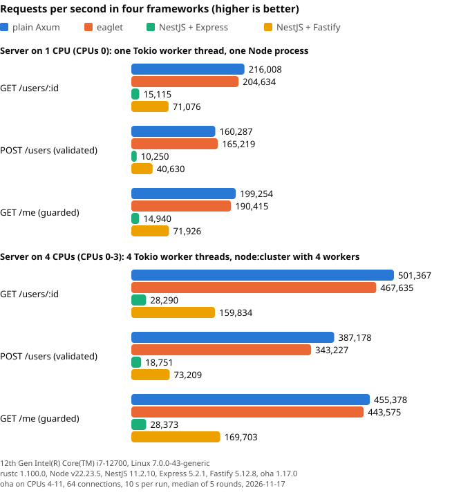

# eaglet

eaglet gives Rust web apps the structure NestJS developers know: modules, dependency injection,
controllers, guards, validation, one error format, testing modules and a generator CLI. Underneath
it is a plain `axum::Router`, so every Axum extractor and Tower middleware keeps working.

**Status:** 0.1. Needs Rust 1.88 or newer.

```console
$ eaglet new shop --db sqlite
create .dockerignore
create .env.example
create .github/workflows/ci.yml
create .gitignore
create AGENTS.md
create CLAUDE.md
create Cargo.toml
create Dockerfile
create README.md
create src/app_module.rs
create src/config.rs
create src/db.rs
create src/health.rs
create src/lib.rs
create src/main.rs
create tests/health.rs

Next: cd shop && cargo run   (API docs at http://localhost:3000/docs)

$ cd shop && eaglet g resource products
update src/app_module.rs
update src/lib.rs
create src/products/controller.rs
create src/products/dto.rs
create src/products/mod.rs
create src/products/repository.rs
create src/products/service.rs
create tests/products.rs
```

The new project builds, passes `cargo clippy -- -D warnings` and its tests as generated, and serves
Swagger UI at `/docs`.

Our own Rust services already used a NestJS-style layout on Axum, with a folder per feature holding
a controller, a service and a repository. What we kept writing by hand in every project was the
wiring between them: who builds what, in which order, and how a test swaps the database for a fake.
eaglet is that layout with the wiring done for you, and checked when the app starts.

## Install

```bash
cargo install eaglet-cli
```

The CLI is called `eaglet`. Projects it creates depend on `eaglet` from crates.io. To work against a
checkout instead, use `eaglet new shop --eaglet-path ../eaglet/crates/eaglet`. Release binaries for
Linux, macOS and Windows are attached to each GitHub release.

## From NestJS in half an hour

This walks through the products feature of [`examples/shop`](examples/shop), next to the NestJS code
you would write for the same thing. `eaglet g resource products` writes the same files with an
in-memory repository, so you can follow along in your own project. Run the finished example with
`cargo run -p shop` and test it with `cargo test -p shop`.

Each step shows the NestJS code first and the eaglet code second. The line above every block says
which one it is and the file it lives in; TypeScript is NestJS, Rust is eaglet.

### 1. A DTO with validation

NestJS puts class-validator decorators on a class and checks them with `ValidationPipe`. eaglet
uses a struct with the `validator` crate's rules.

**NestJS** · `src/products/dto/new-product.dto.ts`

```ts
export class NewProductDto {
  @IsString() @Length(1, 200)
  name: string;

  @IsInt() @Min(1) @Max(100_000_000)
  price_cents: number;
}
```

**eaglet** · [`src/products/dto.rs`](examples/shop/src/products/dto.rs)

```rust
/// The body of `POST /products`.
#[derive(Debug, Deserialize, Validate, ToSchema)]
pub struct NewProduct {
    /// 1 to 200 characters.
    #[validate(length(min = 1, max = 200))]
    pub name: String,
    /// At least 1 cent.
    #[validate(range(min = 1, max = 100_000_000))]
    pub price_cents: i64,
}
```

`ToSchema` puts the struct in the API docs; leave it out and the docs show the body as "any value".

### 2. A service

**NestJS** · `src/products/products.service.ts`

```ts
@Injectable()
export class ProductsService {
  constructor(@Inject(PRODUCTS_REPO) private repo: ProductsRepo) {}

  async find(id: number) {
    const product = await this.repo.get(id);
    if (!product) throw new NotFoundException(`no product with id ${id}`);
    return product;
  }
}
```

**eaglet** · [`src/products/service.rs`](examples/shop/src/products/service.rs)

```rust
#[injectable]
pub struct ProductsService {
    repo: Arc<dyn ProductsRepo>,
}

impl ProductsService {
    // ...
    pub async fn find(&self, id: i64) -> Result<Product, HttpError> {
        self.repo
            .get(id)
            .await?
            .ok_or_else(|| HttpError::not_found(format!("no product with id {id}")))
    }
    // ...
}
```

An `#[injectable]` struct's fields are the providers it needs, each behind an `Arc`. Here the
repository is a trait, so the module decides which storage it gets and a test can hand it a fake.
Errors are values: `HttpError::not_found` is the `NotFoundException`.

The repository trait is ordinary Rust. The shop stores products in SQLite through SQLx:

**eaglet** · [`src/products/repository.rs`](examples/shop/src/products/repository.rs)

```rust
#[async_trait]
pub trait ProductsRepo: Send + Sync {
    // ...
    async fn get(&self, id: i64) -> Result<Option<Product>, HttpError>;
    // ...
}
```

### 3. A controller

**NestJS** · `src/products/products.controller.ts`

```ts
@Controller('products')
export class ProductsController {
  constructor(private products: ProductsService) {}

  @Get(':id')
  find(@Param('id', ParseIntPipe) id: number) {
    return this.products.find(id);
  }

  @Post()
  @UseGuards(AuthGuard)
  create(@Req() req, @Body() input: NewProductDto) {
    return this.products.create(req.user, input);
  }
}
```

**eaglet** · [`src/products/controller.rs`](examples/shop/src/products/controller.rs)

```rust
#[injectable]
pub struct ProductsController {
    products: Arc<ProductsService>,
}

#[controller("/products")]
impl ProductsController {
    // ...
    /// Find one product.
    #[get("/:id")]
    async fn find(&self, Path(id): Path<i64>) -> Result<Json<Product>, HttpError> {
        self.products.find(id).await.map(Json)
    }

    /// Put a product on sale. Needs a signed-in user, who becomes its seller.
    #[post("/")]
    #[guard(AuthGuard)]
    async fn create(
        &self,
        Extension(user): Extension<CurrentUser>,
        Valid(Json(input)): Valid<Json<NewProduct>>,
    ) -> Result<(StatusCode, Json<Product>), HttpError> {
        let product = self.products.create(&user, input).await?;
        Ok((StatusCode::CREATED, Json(product)))
    }
    // ...
}
```

The controller is an `#[injectable]` struct too, and `#[controller]` turns its `impl` block into
routes. Handlers take `&self` and any Axum extractors: `Path` is `@Param`, `Valid<Json<T>>` is
`@Body` plus the validation pipe. A path that does not parse as `i64` is a 400 before the handler
runs, which is what `ParseIntPipe` did. Doc comments become the summaries in the OpenAPI document.

### 4. A module

**NestJS** · `src/products/products.module.ts`

```ts
@Module({
  imports: [AuthModule, DbModule],
  controllers: [ProductsController],
  providers: [ProductsService, { provide: PRODUCTS_REPO, useClass: SqlProductsRepo }],
})
export class ProductsModule {}
```

**eaglet** · [`src/products/mod.rs`](examples/shop/src/products/mod.rs)

```rust
#[module(
    imports = [AuthModule, DbModule],
    controllers = [ProductsController],
    providers = [ProductsService, provide!(dyn ProductsRepo => SqlProductsRepo)]
)]
pub struct ProductsModule;
```

`provide!(dyn ProductsRepo => SqlProductsRepo)` is the `useClass` binding, with the trait as the
token. Visibility works as in NestJS: a module sees its own providers and what its imports export.
Leave the `provide!` line out and the app does not start. The error names both sides:

```text
ProductsService needs dyn ProductsRepo, which ProductsModule does not provide or import
```

### 5. A guard

**NestJS** · `src/auth/auth.guard.ts`

```ts
@Injectable()
export class AuthGuard implements CanActivate {
  constructor(private jwt: JwtService) {}

  canActivate(context: ExecutionContext): boolean {
    const req = context.switchToHttp().getRequest();
    const token = req.headers.authorization?.replace('Bearer ', '');
    if (!token) throw new UnauthorizedException('sign in first');
    req.user = this.jwt.verify(token);
    return true;
  }
}
```

**eaglet** · [`src/auth/guard.rs`](examples/shop/src/auth/guard.rs)

```rust
#[injectable]
pub struct AuthGuard {
    jwt: Arc<JwtService>,
}

impl AuthGuard {
    fn check(&self, parts: &mut Parts) -> Result<(), HttpError> {
        let token = parts
            .headers
            .get(header::AUTHORIZATION)
            .and_then(|v| v.to_str().ok())
            .and_then(|v| v.strip_prefix("Bearer "))
            .ok_or_else(|| {
                HttpError::unauthorized("sign in first: send Authorization: Bearer <token>")
            })?;
        let user = self.jwt.verify(token)?;
        parts.extensions.insert(user);
        Ok(())
    }
}

// ...
impl Guard for AuthGuard {
    fn can_activate(
        &self,
        parts: &mut Parts,
    ) -> impl Future<Output = Result<(), HttpError>> + Send {
        std::future::ready(self.check(parts))
    }
}
```

A guard is a provider that implements `Guard`. It gets the request head before the body is read,
and it hands the user to the handler through `parts.extensions`, where `Extension<CurrentUser>`
picks it up. This check never waits, so it returns a ready future. A guard that looks something up
writes `async fn can_activate` instead ([guide](docs/guide.md#guards)). `AuthModule` lists the
guard in its `exports`, the same way a NestJS module exports a provider for other modules to use.

### 6. Start the app

**NestJS** · `src/main.ts`

```ts
const app = await NestFactory.create(AppModule);
SwaggerModule.setup('docs', app, SwaggerModule.createDocument(app, config));
await app.listen(3000);
```

**eaglet** · [`src/main.rs`](examples/shop/src/main.rs)

```rust
let app = App::new::<AppModule>()
    .await?
    .with_info("Shop API", env!("CARGO_PKG_VERSION"))
    .swagger("/docs");
tracing::info!("listening on http://{addr}, API docs at /docs");
app.listen(addr).await?;
```

`App::new` checks the module tree, builds every provider once, and assembles the router. Every
error, including Axum's own 404 and 405, comes back in one shape with the request's trace id. Here
is a product posted without signing in:

```json
{"code":"UNAUTHORIZED","details":null,"message":"sign in first: send Authorization: Bearer <token>","traceId":"3ab013d14eee2565"}
```

and one with an empty name and a price of zero:

```json
{"code":"VALIDATION_FAILED","details":{"fields":{"name":["length"],"price_cents":["range"]}},"message":"some fields are not valid: name, price_cents","traceId":"dde268b7e87723b3"}
```

### 7. Test it with a fake

NestJS builds a testing module and overrides the repository. `TestApp` does the same: it builds the
real module tree, swaps the providers you name, and sends requests in memory, with no port and no
database.

**NestJS** · `test/products.e2e-spec.ts`

```ts
const module = await Test.createTestingModule({ imports: [AppModule] })
  .overrideProvider(PRODUCTS_REPO).useValue(new FakeProducts())
  .compile();
```

**eaglet** · [`tests/fakes.rs`](examples/shop/tests/fakes.rs)

```rust
async fn app() -> TestApp {
    TestApp::new::<AppModule>()
        .override_provider::<dyn ProductsRepo>(Arc::new(FakeProducts::with_a_lamp()))
        // never connected to: the products repo is fake and these tests sign no one up
        .override_value(sqlx::SqlitePool::connect_lazy("sqlite::memory:").unwrap())
        .override_value(Config {
            port: 0,
            database_url: String::new(),
            jwt_secret: "test-secret".into(),
        })
        .build()
        .await
        .unwrap()
}

// ...
#[tokio::test]
async fn only_the_owner_may_change_a_product() {
    let app = app().await;
    let owner = token_for(&app, 1);
    let stranger = token_for(&app, 2);
    let res = app
        .patch("/products/7")
        .bearer(&stranger)
        .json(&json!({ "name": "Mine now" }))
        .send()
        .await;
    assert_eq!(res.status(), StatusCode::FORBIDDEN);
    // ...
}
```

`override_provider::<dyn ProductsRepo>` only accepts something that implements `ProductsRepo`, so
a wrong fake is a compile error, not a failing test.

## How a request flows


*Guards run before any extractor, so a rejected request never has its body read. Every error leaves
through the same envelope, whether it came from a guard, a validation rule, a handler or Axum
itself.*

The macros write ordinary Axum code: each controller becomes an `axum::Router`, guards become
`route_layer` middleware, and providers are `Arc`s built once at startup. Nothing is looked up at
request time. [`App::into_router`](crates/eaglet/src/app.rs) hands you the router to nest into an
existing Axum app.

## NestJS to eaglet

The left column is what you write in NestJS, the right one what you write in eaglet.

| NestJS | eaglet |
| --- | --- |
| `@Module({ imports, controllers, providers, exports })` | `#[module(imports = [..], controllers = [..], providers = [..], exports = [..])]` on a unit struct |
| `@Injectable()` and constructor injection | `#[injectable]` on a struct whose fields are `Arc<Provider>` |
| `{ provide: TOKEN, useClass: Impl }` | `provide!(dyn Trait => Impl)` |
| `useValue` / async `useFactory` | `ProviderDef::value(v)` / `ProviderDef::factory(\|\| async { .. })` |
| `@Controller('products')`, `@Get(':id')` | `#[controller("/products")]`, `#[get("/:id")]` |
| `@Param()`, `@Query()`, `@Body()` | Axum's `Path<T>`, `Query<T>`, `Json<T>` |
| `ValidationPipe` with class-validator | `Valid<Json<T>>`, `Valid<Query<T>>` with `#[derive(Validate)]` |
| `CanActivate`, `@UseGuards(AuthGuard)` | `impl Guard`, `#[guard(AuthGuard)]` on a controller or a route |
| `req.user` | `parts.extensions.insert(user)` in the guard, `Extension<User>` in the handler |
| Interceptors and middleware | Tower layers, `#[layer(..)]` on a controller or a route |
| `HttpException`, `NotFoundException` | `HttpError::new(..)`, `HttpError::not_found(..)` |
| Exception filters | One JSON envelope for every error, Axum's own included |
| `@nestjs/swagger` | `app.openapi()`, `.swagger("/docs")`, `#[derive(ToSchema)]` on DTOs |
| `Test.createTestingModule().overrideProvider()` | `TestApp::new::<AppModule>().override_provider::<T>(..)` |
| supertest | `app.get("/products").send().await`, in memory |
| `app.get(UsersService)` | `app.provider::<UsersService>()` |
| `NestFactory.create(AppModule)`, `app.listen(3000)` | `App::new::<AppModule>().await?`, `app.listen(addr).await?` |
| `nest new`, `nest g resource` | `eaglet new`, `eaglet g resource` |

The [guide](docs/guide.md) covers each of these in more detail.

## Using eaglet with AI coding tools

[docs/llm-guide.md](docs/llm-guide.md) is a dense reference written for coding agents such as
Claude Code, Codex and Cursor: the exact macro syntax, the layout `eaglet new` makes, code for each
part, and the error messages the common mistakes cause, with their fixes. Its Rust snippets are
checked against code that compiles, like the ones in this README. [llms.txt](llms.txt) points tools
to it and to the rest of the docs.

Projects made by `eaglet new` come with a short `AGENTS.md` that gives the commands, the layout and
the rules, and links to the guide. Its `CLAUDE.md` only imports `AGENTS.md`, so Claude Code reads
the same instructions as every other agent.

## Cargo features

| Feature | Default | Adds |
| --- | --- | --- |
| `validate` | on | `Valid<Json<T>>` and `Valid<Query<T>>` |
| `openapi` | on (through `swagger`) | `app.openapi()`, an OpenAPI 3.1 document |
| `swagger` | on | `.swagger("/docs")`: Swagger UI and `/docs/openapi.json` |
| `testing` | off | `eaglet::testing::TestApp`; turn it on under `[dev-dependencies]` |

## With lumen

[lumen](https://github.com/uniqtechteam/lumen) is our Prisma-style data layer for Rust.
`eaglet new shop --db lumen-postgres` (or `lumen-mongo`) starts the project with a
`prisma/schema.prisma`, a `LumenModule` that provides the generated `Client`, and this function for
turning lumen's Prisma error codes into answers:

```rust
pub fn http(e: lumen_orm::Error) -> HttpError {
    match StatusCode::from_u16(e.http_status()) {
        Ok(status) if status.is_client_error() => HttpError::new(status, e.code, e.message.clone()),
        _ => HttpError::internal(e),
    }
}
```

A missing record becomes a 404, a duplicate a 409, and anything unexpected a 500 that logs the cause
and tells the client nothing. They take `lumen-orm` from crates.io;
`--lumen-path` points them at a lumen checkout instead.

## Performance

The same three routes (a JSON `GET`, a validated `POST`, a guarded `GET`) in plain Axum, in eaglet
and in a NestJS 11 app, loaded with `oha` at 64 connections. The table is the JSON `GET` with the
server held to four CPUs: four Tokio worker threads for Rust, `node:cluster` with four workers for
Node. Memory is the whole server, every process of the cluster included.

| `GET /users/:id`, 4 CPUs | Requests/s | p99 | Memory at rest / under load |
|---|---|---|---|
| plain Axum | 501,367 | 240 µs | 3.4 / 5.9 MB |
| eaglet | 467,635 | 322 µs | 3.5 / 6.0 MB |
| NestJS + Express | 28,290 | 6,815 µs | 413 / 756 MB |
| NestJS + Fastify | 159,834 | 788 µs | 422 / 511 MB |

On one CPU (one worker thread against one Node process) the picture is the same: eaglet answered
2.6 to 2.9 times as many requests as NestJS on Fastify on the `GET` routes and 4.1 to 4.7 times on
the validated `POST`. The routes do almost nothing, so these are the frameworks' own costs; a
handler that waits on a database narrows every gap.



Against plain Axum, eaglet costs about 150 to 200 ns per request: 773 ns against 601 ns for the
JSON `GET` called in memory. Guards and validation cost what the hand-written Axum versions cost;
the difference is the request layer that adds trace ids and the error envelope, and most of it is
what any `Router::layer` costs in Axum. Over HTTP that gap is smaller than the noise between
rounds on the machine we measured on.

Measured with `python3 bench/run.py` on an Intel i7-12700 under Linux, 2026-11-17, medians of five
rounds on a machine shared with other work. The method, every route in both setups, the versions,
the raw numbers and the caveats are in [bench/README.md](bench/README.md).

## Limits

- Every provider is a singleton, built once at startup. There are no request-scoped or transient
  providers, and no lifecycle hooks such as `onModuleInit`.
- `#[injectable]` structs cannot be generic yet.
- There is no built-in `ConfigModule`. Settings are a struct you provide with
  `ProviderDef::value`, as `eaglet new` does.
- There is no per-module exception filter. Errors map to `HttpError` with `map_err` or `From`, and
  all of them share one envelope.
- No ORM in the core. Use SQLx, the MongoDB driver or lumen; `eaglet new --db` sets up each one.
- No GraphQL, WebSockets, server-sent events or microservice transports.
- Swagger UI loads a pinned `swagger-ui-dist` from jsDelivr with integrity hashes. For offline or
  strict-CSP deployments, skip `.swagger()` and serve `app.openapi()` with your own UI.
- Not released yet, so the API may still change before 0.1.

## Contributing

Issues with a small project that shows the problem are the most useful. `cargo test --workspace`
runs everything without a database. The generated-project tests build whole projects, so they are
ignored by default: `cargo test -p eaglet-cli --test generated -- --ignored`.

Every Rust block in this README and in [docs/](docs) is copied from code that builds and runs in
this repository, and `crates/eaglet/tests/docs.rs` fails when one drifts.

## Licence

MIT OR Apache-2.0, at your option.

---

eaglet is made by [UniqTech](https://uniqtech.dev). If your team is moving a NestJS service to Rust
or getting an eaglet app ready for launch, we can help with the migration, a review, or go-live
support.
