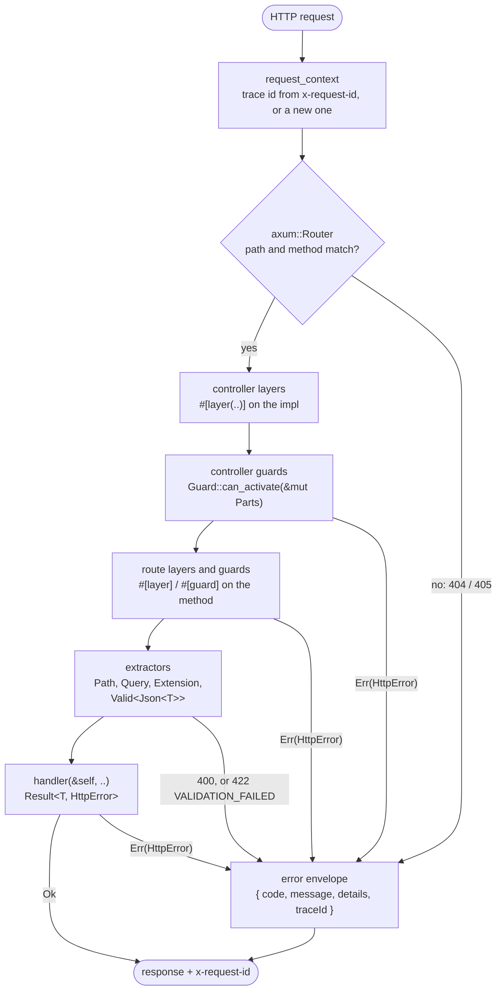

# eaglet

eaglet is a Rust web framework on Axum that gives an app its structure: modules, dependency
injection, controllers, guards, validation, one error format, testing with fakes and a generator
CLI. Underneath it is a plain `axum::Router`, so every Axum extractor and Tower middleware keeps
working.

**Status:** 0.1. Needs Rust 1.88 or newer.

```console
$ eaglet new shop --db sqlite
create .dockerignore
create .env.example
create .github/workflows/ci.yml
create .gitignore
create AGENTS.md
create CLAUDE.md
create Cargo.toml
create Dockerfile
create README.md
create src/app_module.rs
create src/config.rs
create src/db.rs
create src/health.rs
create src/lib.rs
create src/main.rs
create tests/health.rs

Next: cd shop && cargo run   (API docs at http://localhost:3000/docs)

$ cd shop && eaglet g resource products
update src/app_module.rs
update src/lib.rs
create src/products/controller.rs
create src/products/dto.rs
create src/products/mod.rs
create src/products/repository.rs
create src/products/service.rs
create tests/products.rs
```

The new project builds, passes `cargo clippy -- -D warnings` and its tests as generated, and serves
Swagger UI at `/docs`.

## Why

Axum gives you routing and extractors and leaves the shape of the app to you. Our own Rust services
ended up with the same shape every time: a folder per feature holding a controller, a service and a
repository. What we kept writing by hand in every project was the wiring between them: who builds
what, in which order, how a handler reaches the service, and how a test swaps the database for a
fake. That code is easy to get wrong and tedious to read.

eaglet is that layout with the wiring done for you. A module lists what it provides and what it
needs, and `App::new` builds everything once at startup. If something is missing, the app does not
start, and the error names the provider and the module. Requests never look anything up: the
handlers are ordinary Axum handlers that already hold what they need.

## Install

```bash
cargo install eaglet-cli
```

The CLI is called `eaglet`. Projects it creates depend on `eaglet` from crates.io. To work against a
checkout instead, use `eaglet new shop --eaglet-path ../eaglet/crates/eaglet`. Release binaries for
Linux, macOS and Windows are attached to each GitHub release.

## Guides

- [The guide](docs/guide.md): each part on its own, in more detail.
- [For coding agents](docs/llm-guide.md): the exact syntax and the common mistakes, for Claude
  Code, Codex, Cursor and the like.
- Coming from NestJS? See [eaglet for NestJS developers](docs/for-nestjs-developers.md).

## Build a feature in half an hour

This walks through the products feature of [`examples/shop`](examples/shop): a list of products
that anyone can read and that signed-in users can put on sale. `eaglet g resource products` writes
the same files with an in-memory repository, so you can follow along in your own project. Run the
finished example with `cargo run -p shop` and test it with `cargo test -p shop`.

The line above every block names the file it comes from.

### 1. A DTO with validation

A request body is a struct. The `validator` crate's rules on its fields say what a valid body looks
like.

[`src/products/dto.rs`](examples/shop/src/products/dto.rs)

```rust
/// The body of `POST /products`.
#[derive(Debug, Deserialize, Validate, ToSchema)]
pub struct NewProduct {
    /// 1 to 200 characters.
    #[validate(length(min = 1, max = 200))]
    pub name: String,
    /// At least 1 cent.
    #[validate(range(min = 1, max = 100_000_000))]
    pub price_cents: i64,
}
```

`ToSchema` puts the struct in the API docs; leave it out and the docs show the body as "any value".

### 2. A service

The business rules live in a service. It needs somewhere to keep products, so it asks for a
repository.

[`src/products/service.rs`](examples/shop/src/products/service.rs)

```rust
#[injectable]
pub struct ProductsService {
    repo: Arc<dyn ProductsRepo>,
}

impl ProductsService {
    // ...
    pub async fn find(&self, id: i64) -> Result<Product, HttpError> {
        self.repo
            .get(id)
            .await?
            .ok_or_else(|| HttpError::not_found(format!("no product with id {id}")))
    }
    // ...
}
```

An `#[injectable]` struct's fields are the providers it needs, each behind an `Arc`. You never call
a constructor: the app builds the service once and hands it the repository. Here the repository is a
trait, so the module decides which storage it gets and a test can hand it a fake. Errors are values:
`HttpError::not_found` becomes a 404.

The repository trait is ordinary Rust. The shop stores products in SQLite through SQLx:

[`src/products/repository.rs`](examples/shop/src/products/repository.rs)

```rust
#[async_trait]
pub trait ProductsRepo: Send + Sync {
    // ...
    async fn get(&self, id: i64) -> Result<Option<Product>, HttpError>;
    // ...
}
```

### 3. A controller

[`src/products/controller.rs`](examples/shop/src/products/controller.rs)

```rust
#[injectable]
pub struct ProductsController {
    products: Arc<ProductsService>,
}

#[controller("/products")]
impl ProductsController {
    // ...
    /// Find one product.
    #[get("/:id")]
    async fn find(&self, Path(id): Path<i64>) -> Result<Json<Product>, HttpError> {
        self.products.find(id).await.map(Json)
    }

    /// Put a product on sale. Needs a signed-in user, who becomes its seller.
    #[post("/")]
    #[guard(AuthGuard)]
    async fn create(
        &self,
        Extension(user): Extension<CurrentUser>,
        Valid(Json(input)): Valid<Json<NewProduct>>,
    ) -> Result<(StatusCode, Json<Product>), HttpError> {
        let product = self.products.create(&user, input).await?;
        Ok((StatusCode::CREATED, Json(product)))
    }
    // ...
}
```

The controller is an `#[injectable]` struct too, and `#[controller]` turns its `impl` block into
routes. Handlers take `&self` and any Axum extractors. `Valid<Json<T>>` reads the body and checks
the rules from step 1, so the handler only ever sees a valid `NewProduct`. A path that does not
parse as `i64` is a 400 before the handler runs. Doc comments become the summaries in the OpenAPI
document.

### 4. A module

A module ties the pieces together and says which storage the repository trait gets.

[`src/products/mod.rs`](examples/shop/src/products/mod.rs)

```rust
#[module(
    imports = [AuthModule, DbModule],
    controllers = [ProductsController],
    providers = [ProductsService, provide!(dyn ProductsRepo => SqlProductsRepo)]
)]
pub struct ProductsModule;
```

`provide!(dyn ProductsRepo => SqlProductsRepo)` binds the trait to the SQLite version. A module
sees its own providers and what its imports export, nothing else. Leave the `provide!` line out and
the app does not start. The error names both sides:

```text
ProductsService needs dyn ProductsRepo, which ProductsModule does not provide or import
```

### 5. A guard

Only a signed-in user may put a product on sale. That check is a guard.

[`src/auth/guard.rs`](examples/shop/src/auth/guard.rs)

```rust
#[injectable]
pub struct AuthGuard {
    jwt: Arc<JwtService>,
}

impl AuthGuard {
    fn check(&self, parts: &mut Parts) -> Result<(), HttpError> {
        let token = parts
            .headers
            .get(header::AUTHORIZATION)
            .and_then(|v| v.to_str().ok())
            .and_then(|v| v.strip_prefix("Bearer "))
            .ok_or_else(|| {
                HttpError::unauthorized("sign in first: send Authorization: Bearer <token>")
            })?;
        let user = self.jwt.verify(token)?;
        parts.extensions.insert(user);
        Ok(())
    }
}

// ...
impl Guard for AuthGuard {
    fn can_activate(
        &self,
        parts: &mut Parts,
    ) -> impl Future<Output = Result<(), HttpError>> + Send {
        std::future::ready(self.check(parts))
    }
}
```

A guard is a provider that implements `Guard`. It gets the request head before the body is read,
and it hands the user to the handler through `parts.extensions`, where `Extension<CurrentUser>`
picks it up. This check never waits, so it returns a ready future. A guard that looks something up
writes `async fn can_activate` instead ([guide](docs/guide.md#guards)). `AuthModule` lists the
guard in its `exports`, so `ProductsModule` can use it by importing `AuthModule`.

### 6. Start the app

[`src/main.rs`](examples/shop/src/main.rs)

```rust
let app = App::new::<AppModule>()
    .await?
    .with_info("Shop API", env!("CARGO_PKG_VERSION"))
    .swagger("/docs");
tracing::info!("listening on http://{addr}, API docs at /docs");
app.listen(addr).await?;
```

`App::new` checks the module tree, builds every provider once, and assembles the router. Every
error, including Axum's own 404 and 405, comes back in one shape with the request's trace id. Here
is a product posted without signing in:

```json
{"code":"UNAUTHORIZED","details":null,"message":"sign in first: send Authorization: Bearer <token>","traceId":"3ab013d14eee2565"}
```

and one with an empty name and a price of zero:

```json
{"code":"VALIDATION_FAILED","details":{"fields":{"name":["length"],"price_cents":["range"]}},"message":"some fields are not valid: name, price_cents","traceId":"dde268b7e87723b3"}
```

### 7. Test it with a fake

`TestApp` builds the real module tree, swaps the providers you name, and sends requests in memory,
with no port and no database.

[`tests/fakes.rs`](examples/shop/tests/fakes.rs)

```rust
async fn app() -> TestApp {
    TestApp::new::<AppModule>()
        .override_provider::<dyn ProductsRepo>(Arc::new(FakeProducts::with_a_lamp()))
        // never connected to: the products repo is fake and these tests sign no one up
        .override_value(sqlx::SqlitePool::connect_lazy("sqlite::memory:").unwrap())
        .override_value(Config {
            port: 0,
            database_url: String::new(),
            jwt_secret: "test-secret".into(),
        })
        .build()
        .await
        .unwrap()
}

// ...
#[tokio::test]
async fn only_the_owner_may_change_a_product() {
    let app = app().await;
    let owner = token_for(&app, 1);
    let stranger = token_for(&app, 2);
    let res = app
        .patch("/products/7")
        .bearer(&stranger)
        .json(&json!({ "name": "Mine now" }))
        .send()
        .await;
    assert_eq!(res.status(), StatusCode::FORBIDDEN);
    // ...
}
```

`override_provider::<dyn ProductsRepo>` only accepts something that implements `ProductsRepo`, so
a wrong fake is a compile error, not a failing test.

## How a request flows



*Guards run before any extractor, so a rejected request never has its body read. Every error leaves
through the same envelope, whether it came from a guard, a validation rule, a handler or Axum
itself.*

The macros write ordinary Axum code: each controller becomes an `axum::Router`, guards become
`route_layer` middleware, and providers are `Arc`s built once at startup. Nothing is looked up at
request time. [`App::into_router`](crates/eaglet/src/app.rs) hands you the router to merge into an
existing Axum app.

## Compared with plain Axum

| You want | In plain Axum | In eaglet |
| --- | --- | --- |
| Share a service between handlers | build it in `main`, put it in `State`, pass `State<T>` around | list it in a module, hold it as an `Arc` field |
| Swap the database in a test | thread a trait object through by hand | `TestApp::override_provider::<dyn Trait>(..)` |
| Check a token on some routes | a `route_layer` per group of routes | `#[guard(AuthGuard)]` on the controller or the route |
| Validate a body | call `validate()` in each handler | take `Valid<Json<T>>` |
| One error format | an `IntoResponse` type, plus a fallback for Axum's own rejections | `HttpError`, and Axum's errors already share its envelope |
| API docs | write the utoipa paths by hand | `#[controller]` routes and doc comments feed `app.openapi()` |

Anything Axum offers still works inside eaglet: extractors, `Router::merge`, Tower layers, your own
server setup. When a part of the app does not fit, write it as plain Axum and merge it in.

## Using eaglet with AI coding tools

[docs/llm-guide.md](docs/llm-guide.md) is a dense reference written for coding agents such as
Claude Code, Codex and Cursor: the exact macro syntax, the layout `eaglet new` makes, code for each
part, and the error messages the common mistakes cause, with their fixes. Its Rust snippets are
checked against code that compiles, like the ones in this README. [llms.txt](llms.txt) points tools
to it and to the rest of the docs.

Projects made by `eaglet new` come with a short `AGENTS.md` that gives the commands, the layout and
the rules, and links to the guide. Its `CLAUDE.md` only imports `AGENTS.md`, so Claude Code reads
the same instructions as every other agent.

## Cargo features

| Feature | Default | Adds |
| --- | --- | --- |
| `validate` | on | `Valid<Json<T>>` and `Valid<Query<T>>` |
| `openapi` | on (through `swagger`) | `app.openapi()`, an OpenAPI 3.1 document |
| `swagger` | on | `.swagger("/docs")`: Swagger UI and `/docs/openapi.json` |
| `testing` | off | `eaglet::testing::TestApp`; turn it on under `[dev-dependencies]` |

## With lumen

[lumen](https://github.com/uniqtechteam/lumen) is our data layer: it turns a schema file into
migrations, a typed client and a query builder, for Postgres and MongoDB.
`eaglet new shop --db lumen-postgres` (or `lumen-mongo`) starts the project with a
`prisma/schema.prisma`, a `LumenModule` that provides the generated `Client`, and this function for
turning lumen's error codes into answers:

```rust
pub fn http(e: lumen_orm::Error) -> HttpError {
    match StatusCode::from_u16(e.http_status()) {
        Ok(status) if status.is_client_error() => HttpError::new(status, e.code, e.message.clone()),
        _ => HttpError::internal(e),
    }
}
```

A missing record becomes a 404, a duplicate a 409, and anything unexpected a 500 that logs the cause
and tells the client nothing. They take `lumen-orm` from crates.io;
`--lumen-path` points them at a lumen checkout instead.

## Performance

The same three routes (a JSON `GET`, a validated `POST`, a guarded `GET`) in plain Axum and in
eaglet, loaded with `oha` at 64 connections with the server held to four CPUs, and called in memory
to measure each framework's own cost per request.

| Route | Plain Axum | eaglet | Difference |
|---|---|---|---|
| `GET /users/:id` | 501,367 req/s, 601 ns | 467,635 req/s, 773 ns | -6.7%, +172 ns |
| `POST /users` (validated) | 387,178 req/s, 1,514 ns | 343,227 req/s, 1,716 ns | -11.4%, +202 ns |
| `GET /me` (guarded) | 455,378 req/s, 976 ns | 443,575 req/s, 1,124 ns | -2.6%, +148 ns |


eaglet costs about 150 to 200 ns per request over plain Axum. Guards and validation cost what the
hand-written Axum versions cost; the difference is the request layer that adds trace ids and the
error envelope, and most of it is what any `Router::layer` costs in Axum. Over HTTP that gap is
smaller than the noise between rounds on the machine we measured on, which is why the in-memory
column is the one to read. The routes do almost nothing, so this is the framework's share at its
largest; a handler that waits on a database makes it smaller.

Measured with `python3 bench/run.py` on an Intel i7-12700 under Linux, 2026-11-17, medians of five
rounds on a machine shared with other work. The routes are in
[`bench/src`](bench/src), the script in [`bench/run.py`](bench/run.py) and the medians in
[`bench/results.csv`](bench/results.csv).

## Limits

- Every provider is a singleton, built once at startup. There are no request-scoped or transient
  providers, and no hooks that run once the providers are built.
- `#[injectable]` structs cannot be generic yet.
- There is no built-in config module. Settings are a struct you provide with
  `ProviderDef::value`, as `eaglet new` does.
- The error format cannot change per module. Errors map to `HttpError` with `map_err` or `From`,
  and all of them share one envelope.
- No ORM in the core. Use SQLx, the MongoDB driver or lumen; `eaglet new --db` sets up each one.
- No GraphQL, WebSockets, server-sent events or microservice transports.
- Swagger UI loads a pinned `swagger-ui-dist` from jsDelivr with integrity hashes. For offline or
  strict-CSP deployments, skip `.swagger()` and serve `app.openapi()` with your own UI.
- Version 0.1, so the API may still change between 0.x releases.

## Contributing

Issues with a small project that shows the problem are the most useful. `cargo test --workspace`
runs everything without a database. The generated-project tests build whole projects, so they are
ignored by default: `cargo test -p eaglet-cli --test generated -- --ignored`.

Every Rust block in this README and in [docs/](docs) is copied from code that builds and runs in
this repository, and `crates/eaglet/tests/docs.rs` fails when one drifts.

## Licence

MIT OR Apache-2.0, at your option.

---

eaglet is made by [UniqTech](https://uniqtech.dev). If your team is moving a service to Rust or
getting an eaglet app ready for launch, we can help with the migration, a review, or go-live
support.
