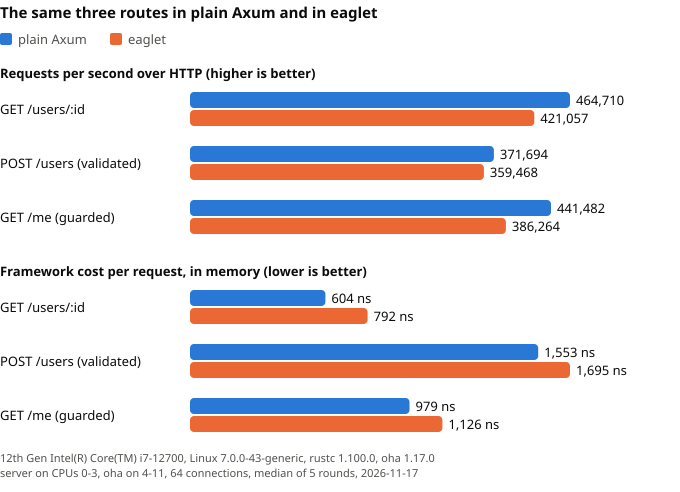

# Benchmark: eaglet against plain Axum

eaglet builds a plain `axum::Router`, so the question is what it adds on top. This folder answers it
with the same three routes written twice, once in plain Axum and once as an eaglet module, and a
script that loads both.



## Results

Measured on 2026-11-17 on an Intel i7-12700 (Linux 7.0, rustc 1.100.0, oha 1.17.0). Medians of five
rounds; every round is in [results.json](results.json), the medians in [results.csv](results.csv).

| Route | Plain Axum | eaglet | Difference |
|---|---|---|---|
| `GET /users/:id` | 478,376 req/s, 634 ns | 424,099 req/s, 1,135 ns | -11.3%, +501 ns |
| `POST /users` (validated) | 384,163 req/s, 1,581 ns | 344,209 req/s, 2,134 ns | -10.4%, +553 ns |
| `GET /me` (guarded) | 439,128 req/s, 996 ns | 399,281 req/s, 1,474 ns | -9.1%, +478 ns |

Requests per second are over HTTP with the server held to 4 logical CPUs; nanoseconds are the
framework's own cost per request, called in memory on one core.

**eaglet costs about half a microsecond per request over plain Axum.** When the server has nothing
to do but answer these tiny routes, that shows up as 9 to 11% fewer requests per second. Median
latency over HTTP moves from 126 to 145 µs on the GET route; p99 moves both ways, within the
spread between rounds.

The extra time is about the same on all three routes, so it does not come from guards or
validation; those cost what the hand-written Axum versions cost. It sits in what every request goes
through, and most of it is the request layer every eaglet app runs first:
it makes a trace id, keeps it in a task-local for the handler and the logs, turns error responses
into the JSON envelope and adds the `x-request-id` header. Plain Axum in this bench does none of
that. An Axum app that adds its own request ids and error mapping pays for them too.

For an endpoint that reads a database or calls another service, half a microsecond is lost in the
noise. For a service whose whole job is answering trivial routes as fast as possible, plain Axum is
measurably faster today.

## The routes

| Route | What both versions do |
|---|---|
| `GET /users/:id` | path parameter in, a small JSON object out |
| `POST /users` | JSON body checked with `validator` (name length, email), 201 with the user, 422 if invalid |
| `GET /me` | a bearer-token guard runs first and puts the user on the request; the handler returns it |

Both versions call the same `Users` service through an `Arc`. The plain one validates in the
handler and guards with a `route_layer`, the way a careful Axum app would. The eaglet one uses
`#[controller]`, `Valid<Json<T>>` and `#[guard]`. `tests/same_answers.rs` checks that both answer
every bench request with the same status and body, so the numbers compare the same work.

## Method

- `bench-server axum|eaglet <port>` serves one version on `127.0.0.1`.
- `run.py` starts each server pinned with `taskset` to CPUs 0-3 and runs `oha` pinned to CPUs 4-11,
  64 connections, 3 seconds of warm-up and then 10 seconds measured. Each round runs every route on
  both servers, and the order flips every round, so a busy moment on the machine hits both sides.
  It stops if any response has an unexpected status.
- `bench-inproc` calls both routers with `tower::ServiceExt::oneshot`, no sockets, 200,000 requests
  per sample, seven samples, and reports the median nanoseconds per request. This is the cleanest
  view of the framework's own cost, because the network stack and the load generator are out of it.
- `plot.py` draws `docs/img/bench-axum.svg` from `results.json`.

## Run it

```bash
cargo install oha --locked
cargo build --release -p eaglet-bench
python3 bench/run.py      # about seven minutes; writes results.json and results.csv
python3 bench/plot.py     # redraws docs/img/bench-axum.svg
```

`run.py` takes the release folder as its argument when `CARGO_TARGET_DIR` points elsewhere, and
reads `BENCH_SERVER_CPUS`, `BENCH_LOAD_CPUS`, `BENCH_CONNECTIONS`, `BENCH_SECONDS` and
`BENCH_ROUNDS` from the environment.

## Caveats

- The server and the load generator share one machine. They are on separate cores, but they share
  caches and memory bandwidth, and other work was running on the machine (load average 6.5 when the
  run started, 4.9 at the end). Most rounds agree within a few percent; two rounds where the machine
  got busy are visible in `results.json`, and the median keeps them out. The in-memory numbers
  agree within 4%.
- The routes do almost nothing on purpose, which makes the framework's share as large as it can be.
  Real handlers make it smaller.
- One machine, one OS. Numbers on other hardware will differ; the gap in nanoseconds is the part to
  compare.
