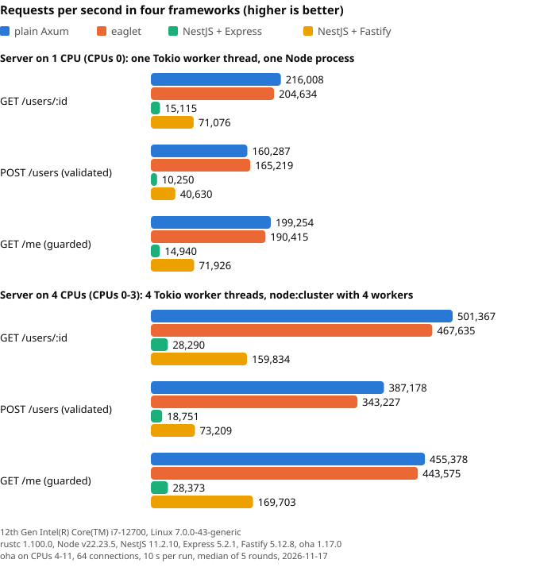

# eaglet for NestJS developers

eaglet borrows its shape from NestJS: modules that import and export providers, injectable
services, controllers, guards, a validation step and a testing module that swaps providers. If you
have built a Nest app, most of eaglet will look familiar, and this page shows where each piece went
and what works differently in Rust.

The [README](../README.md) and the [guide](guide.md) explain eaglet without assuming you know
NestJS. This page is only the translation.

## Concepts side by side

The left column is what you write in NestJS, the right one what you write in eaglet.

| NestJS | eaglet |
| --- | --- |
| `@Module({ imports, controllers, providers, exports })` | `#[module(imports = [..], controllers = [..], providers = [..], exports = [..])]` on a unit struct |
| `@Injectable()` and constructor injection | `#[injectable]` on a struct whose fields are `Arc<Provider>` |
| `{ provide: TOKEN, useClass: Impl }` | `provide!(dyn Trait => Impl)` |
| `useValue` / async `useFactory` | `ProviderDef::value(v)` / `ProviderDef::factory(\|\| async { .. })` |
| `@Controller('products')`, `@Get(':id')` | `#[controller("/products")]`, `#[get("/:id")]` |
| `@Param()`, `@Query()`, `@Body()` | Axum's `Path<T>`, `Query<T>`, `Json<T>` |
| `ValidationPipe` with class-validator | `Valid<Json<T>>`, `Valid<Query<T>>` with `#[derive(Validate)]` |
| `ParseIntPipe` | the type in `Path<i64>`; a path that does not parse is a 400 |
| `CanActivate`, `@UseGuards(AuthGuard)` | `impl Guard`, `#[guard(AuthGuard)]` on a controller or a route |
| `req.user` | `parts.extensions.insert(user)` in the guard, `Extension<User>` in the handler |
| Interceptors and middleware | Tower layers, `#[layer(..)]` on a controller or a route |
| `HttpException`, `NotFoundException` | `HttpError::new(..)`, `HttpError::not_found(..)` |
| Exception filters | One JSON envelope for every error, Axum's own included |
| `@nestjs/swagger` | `app.openapi()`, `.swagger("/docs")`, `#[derive(ToSchema)]` on DTOs |
| `Test.createTestingModule().overrideProvider()` | `TestApp::new::<AppModule>().override_provider::<T>(..)` |
| supertest | `app.get("/products").send().await`, in memory |
| `app.get(UsersService)` | `app.provider::<UsersService>()` |
| `NestFactory.create(AppModule)`, `app.listen(3000)` | `App::new::<AppModule>().await?`, `app.listen(addr).await?` |
| `nest new`, `nest g resource` | `eaglet new`, `eaglet g resource` |

## The same feature in both

This is the products feature of [`examples/shop`](../examples/shop), next to the NestJS code you
would write for the same thing. Each step shows the NestJS code first and the eaglet code second.
The line above every block says which one it is and the file it lives in; TypeScript is NestJS,
Rust is eaglet.

### 1. A DTO with validation

NestJS puts class-validator decorators on a class and checks them with `ValidationPipe`. eaglet
uses a struct with the `validator` crate's rules.

**NestJS** · `src/products/dto/new-product.dto.ts`

```ts
export class NewProductDto {
  @IsString() @Length(1, 200)
  name: string;

  @IsInt() @Min(1) @Max(100_000_000)
  price_cents: number;
}
```

**eaglet** · [`src/products/dto.rs`](../examples/shop/src/products/dto.rs)

```rust
/// The body of `POST /products`.
#[derive(Debug, Deserialize, Validate, ToSchema)]
pub struct NewProduct {
    /// 1 to 200 characters.
    #[validate(length(min = 1, max = 200))]
    pub name: String,
    /// At least 1 cent.
    #[validate(range(min = 1, max = 100_000_000))]
    pub price_cents: i64,
}
```

`ToSchema` does what the `@ApiProperty` decorators do: it puts the struct in the API docs.

### 2. A service

**NestJS** · `src/products/products.service.ts`

```ts
@Injectable()
export class ProductsService {
  constructor(@Inject(PRODUCTS_REPO) private repo: ProductsRepo) {}

  async find(id: number) {
    const product = await this.repo.get(id);
    if (!product) throw new NotFoundException(`no product with id ${id}`);
    return product;
  }
}
```

**eaglet** · [`src/products/service.rs`](../examples/shop/src/products/service.rs)

```rust
#[injectable]
pub struct ProductsService {
    repo: Arc<dyn ProductsRepo>,
}

impl ProductsService {
    // ...
    pub async fn find(&self, id: i64) -> Result<Product, HttpError> {
        self.repo
            .get(id)
            .await?
            .ok_or_else(|| HttpError::not_found(format!("no product with id {id}")))
    }
    // ...
}
```

The constructor parameters become fields, each behind an `Arc`. The injection token is the trait
itself, `dyn ProductsRepo`, so there is no `PRODUCTS_REPO` constant and no `@Inject`. Errors are
values: `HttpError::not_found` is the `NotFoundException`, returned instead of thrown.

### 3. A controller

**NestJS** · `src/products/products.controller.ts`

```ts
@Controller('products')
export class ProductsController {
  constructor(private products: ProductsService) {}

  @Get(':id')
  find(@Param('id', ParseIntPipe) id: number) {
    return this.products.find(id);
  }

  @Post()
  @UseGuards(AuthGuard)
  create(@Req() req, @Body() input: NewProductDto) {
    return this.products.create(req.user, input);
  }
}
```

**eaglet** · [`src/products/controller.rs`](../examples/shop/src/products/controller.rs)

```rust
#[injectable]
pub struct ProductsController {
    products: Arc<ProductsService>,
}

#[controller("/products")]
impl ProductsController {
    // ...
    /// Find one product.
    #[get("/:id")]
    async fn find(&self, Path(id): Path<i64>) -> Result<Json<Product>, HttpError> {
        self.products.find(id).await.map(Json)
    }

    /// Put a product on sale. Needs a signed-in user, who becomes its seller.
    #[post("/")]
    #[guard(AuthGuard)]
    async fn create(
        &self,
        Extension(user): Extension<CurrentUser>,
        Valid(Json(input)): Valid<Json<NewProduct>>,
    ) -> Result<(StatusCode, Json<Product>), HttpError> {
        let product = self.products.create(&user, input).await?;
        Ok((StatusCode::CREATED, Json(product)))
    }
    // ...
}
```

`Path` is `@Param`, `Valid<Json<T>>` is `@Body` plus the validation pipe, and `Extension<CurrentUser>`
is `req.user`. A path that does not parse as `i64` is a 400 before the handler runs, which is what
`ParseIntPipe` did. Doc comments take the place of `@ApiOperation` summaries.

### 4. A module

**NestJS** · `src/products/products.module.ts`

```ts
@Module({
  imports: [AuthModule, DbModule],
  controllers: [ProductsController],
  providers: [ProductsService, { provide: PRODUCTS_REPO, useClass: SqlProductsRepo }],
})
export class ProductsModule {}
```

**eaglet** · [`src/products/mod.rs`](../examples/shop/src/products/mod.rs)

```rust
#[module(
    imports = [AuthModule, DbModule],
    controllers = [ProductsController],
    providers = [ProductsService, provide!(dyn ProductsRepo => SqlProductsRepo)]
)]
pub struct ProductsModule;
```

`provide!(dyn ProductsRepo => SqlProductsRepo)` is the `useClass` binding, with the trait as the
token. Visibility works as in NestJS: a module sees its own providers and what its imports export.
Leave the `provide!` line out and the app does not start, as Nest would not either. The error names
both sides:

```text
ProductsService needs dyn ProductsRepo, which ProductsModule does not provide or import
```

### 5. A guard

**NestJS** · `src/auth/auth.guard.ts`

```ts
@Injectable()
export class AuthGuard implements CanActivate {
  constructor(private jwt: JwtService) {}

  canActivate(context: ExecutionContext): boolean {
    const req = context.switchToHttp().getRequest();
    const token = req.headers.authorization?.replace('Bearer ', '');
    if (!token) throw new UnauthorizedException('sign in first');
    req.user = this.jwt.verify(token);
    return true;
  }
}
```

**eaglet** · [`src/auth/guard.rs`](../examples/shop/src/auth/guard.rs)

```rust
#[injectable]
pub struct AuthGuard {
    jwt: Arc<JwtService>,
}

impl AuthGuard {
    fn check(&self, parts: &mut Parts) -> Result<(), HttpError> {
        let token = parts
            .headers
            .get(header::AUTHORIZATION)
            .and_then(|v| v.to_str().ok())
            .and_then(|v| v.strip_prefix("Bearer "))
            .ok_or_else(|| {
                HttpError::unauthorized("sign in first: send Authorization: Bearer <token>")
            })?;
        let user = self.jwt.verify(token)?;
        parts.extensions.insert(user);
        Ok(())
    }
}

// ...
impl Guard for AuthGuard {
    fn can_activate(
        &self,
        parts: &mut Parts,
    ) -> impl Future<Output = Result<(), HttpError>> + Send {
        std::future::ready(self.check(parts))
    }
}
```

Instead of an `ExecutionContext`, a guard gets the request head (`Parts`) before the body is read.
Where Nest sets `req.user`, an eaglet guard puts the user in `parts.extensions`. `AuthModule` lists
the guard in its `exports`, the same way a NestJS module exports a provider for other modules to use.

### 6. Start the app

**NestJS** · `src/main.ts`

```ts
const app = await NestFactory.create(AppModule);
SwaggerModule.setup('docs', app, SwaggerModule.createDocument(app, config));
await app.listen(3000);
```

**eaglet** · [`src/main.rs`](../examples/shop/src/main.rs)

```rust
let app = App::new::<AppModule>()
    .await?
    .with_info("Shop API", env!("CARGO_PKG_VERSION"))
    .swagger("/docs");
tracing::info!("listening on http://{addr}, API docs at /docs");
app.listen(addr).await?;
```

`.swagger("/docs")` is `SwaggerModule.setup('docs', ..)`: it serves Swagger UI and the document
built from the controllers, with no separate `createDocument` step.

### 7. Test it with a fake

NestJS builds a testing module and overrides the repository. `TestApp` does the same: it builds the
real module tree, swaps the providers you name, and sends requests in memory, with no port and no
database, so there is no need for supertest.

**NestJS** · `test/products.e2e-spec.ts`

```ts
const module = await Test.createTestingModule({ imports: [AppModule] })
  .overrideProvider(PRODUCTS_REPO).useValue(new FakeProducts())
  .compile();
```

**eaglet** · [`tests/fakes.rs`](../examples/shop/tests/fakes.rs)

```rust
async fn app() -> TestApp {
    TestApp::new::<AppModule>()
        .override_provider::<dyn ProductsRepo>(Arc::new(FakeProducts::with_a_lamp()))
        // never connected to: the products repo is fake and these tests sign no one up
        .override_value(sqlx::SqlitePool::connect_lazy("sqlite::memory:").unwrap())
        .override_value(Config {
            port: 0,
            database_url: String::new(),
            jwt_secret: "test-secret".into(),
        })
        .build()
        .await
        .unwrap()
}
```

`override_provider::<dyn ProductsRepo>` only accepts something that implements `ProductsRepo`, so
a wrong fake is a compile error, not a failing test.

## What works differently

- **Errors are returned, not thrown.** Handlers, services and guards return
  `Result<T, HttpError>`, and `?` passes an error up. There are no exception filters: every error,
  including Axum's own 404 and 405 and a rejected extractor, leaves in one JSON envelope with
  `code`, `message`, `details` and `traceId`.
- **Validation failures are 422, not 400.** `Valid<Json<T>>` answers 422 with the code
  `VALIDATION_FAILED` and the failing fields in `details`. `ValidationPipe` answers 400 by default.
- **A guard says why.** A Nest guard that returns `false` gives a 403. An eaglet guard returns the
  `HttpError` you choose, so a missing token can be a 401 and a wrong role a 403.
- **Wiring is checked at startup, once.** A missing provider, a circle of providers, a provider
  declared twice or an export the module does not have stops `App::new` with an error that names
  the provider and the module. Requests never resolve anything; providers are `Arc`s built before
  the first request.
- **Every provider is a singleton.** There is no `Scope.REQUEST` or `Scope.TRANSIENT`. Per-request
  data travels in request extensions, the way the guard hands over the user.
- **No lifecycle hooks.** There is no `onModuleInit` or `onApplicationShutdown`. Work that must
  happen at startup goes in an async factory (`ProviderDef::factory`), whose error stops the app.
- **No `ConfigModule`.** Settings are a plain struct provided with `ProviderDef::value`, which
  `eaglet new` sets up from environment variables.
- **No decorators on parameters.** A handler's arguments are Axum extractors, and their types say
  what is read: `Path<i64>`, `Query<Filter>`, `Json<NewProduct>`. Any Axum extractor works.
- **Interceptors are Tower layers.** `#[layer(..)]` takes any Tower layer, so timeouts, compression
  and tracing come from `tower-http` instead of being written as interceptors.
- **No dynamic modules.** `forRoot()` and `forRootAsync()` have no direct counterpart. A module
  that needs settings imports the module that provides them, or takes them from a factory.
- **Not in eaglet:** GraphQL, WebSockets, server-sent events and microservice transports.

## Speed

We ran the same three routes (a JSON `GET`, a validated `POST`, a guarded `GET`) in plain Axum, in
eaglet and in a NestJS 11 app, loaded with `oha` at 64 connections. The table is the JSON `GET`
with the server held to four CPUs: four Tokio worker threads for Rust, `node:cluster` with four
workers for Node. Memory is the whole server, every process of the cluster included.

| `GET /users/:id`, 4 CPUs | Requests/s | p99 | Memory at rest / under load |
|---|---|---|---|
| plain Axum | 501,367 | 240 µs | 3.4 / 5.9 MB |
| eaglet | 467,635 | 322 µs | 3.5 / 6.0 MB |
| NestJS + Express | 28,290 | 6,815 µs | 413 / 756 MB |
| NestJS + Fastify | 159,834 | 788 µs | 422 / 511 MB |

On one CPU (one worker thread against one Node process) the picture is the same: eaglet answered
2.6 to 2.9 times as many requests as NestJS on Fastify on the `GET` routes and 4.1 to 4.7 times on
the validated `POST`. The routes do almost nothing, so these are the frameworks' own costs; a
handler that waits on a database narrows every gap.



The Node numbers are not a ceiling for Node. They are what a Nest 11 app written the usual way
gets, compiled with `tsc` and run in production mode with the logger off. A newer Node or a
different validation library will move them.

Measured with `python3 bench/run.py` on an Intel i7-12700 under Linux, 2026-11-17, medians of five
rounds on a machine shared with other work. The method, every route in each framework, the
versions, the raw numbers and the caveats are in [bench/README.md](../bench/README.md).
