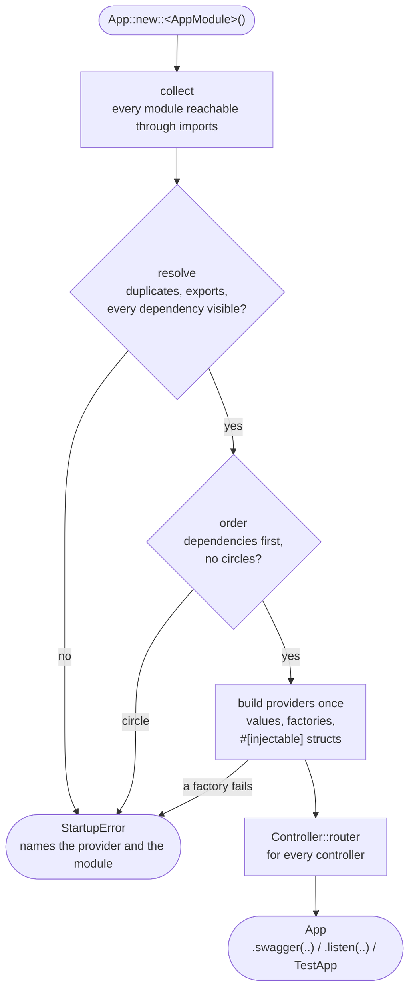

# The eaglet guide

The README walks through one feature of the shop example. This guide covers each part on its own:
modules and providers, controllers, guards, validation, errors, layers, testing, the API docs and
the command line.

Most examples here come from [`crates/eaglet/tests/guide.rs`](../crates/eaglet/tests/guide.rs), a
small app with a mailer, an API key guard and one controller. It runs with `cargo test -p eaglet
--test guide`, so the code below is known to compile and behave as described.

## Modules and providers

A provider is anything the app builds once and shares. The most common kind is an `#[injectable]`
struct. Its fields are the providers it needs, each held as an `Arc`:

```rust
#[injectable]
struct Greeter {
    mailer: Arc<dyn Mailer>,
    #[inject(default)]
    sent: AtomicU64,
}
```

`mailer` is another provider, here a trait object. `#[inject(default)]` fills a field with
`Default::default()` instead, for state the provider owns, such as a counter or a cache. Any other
field type is a compile error that tells you to use `Arc<..>`.

A module is a unit struct that declares its providers, the modules it imports and the providers it
exports:

```rust
#[module(
    providers = [
        ProviderDef::value(MailSettings { from: "shop@example.com".into() }),
        provide!(dyn Mailer => SmtpMailer),
    ],
    exports = [dyn Mailer]
)]
struct MailModule;
```

`providers` takes four kinds of entries:

| Entry | Builds |
| --- | --- |
| `Greeter` | the `#[injectable]` struct, from its fields |
| `provide!(dyn Mailer => SmtpMailer)` | `SmtpMailer`, available as `Arc<dyn Mailer>` |
| `ProviderDef::value(v)` | nothing; `v` is used as it is |
| `ProviderDef::factory(\|\| async { .. })` | whatever the async function returns, at startup |

A factory returns a `Result`, and its error stops the app. This is how a database pool is usually
made:

```rust
async fn connect(size: u32) -> Result<Pool, std::io::Error> {
    Ok(Pool { size })
}

#[module(
    providers = [ProviderDef::factory(|| async { connect(5).await })],
    exports = [Pool]
)]
struct DbModule;
```

The shop example connects to SQLite the same way, in
[`examples/shop/src/db.rs`](../examples/shop/src/db.rs).

The root module imports the others:

```rust
#[module(
    imports = [MailModule, DbModule],
    controllers = [ReportsController],
    providers = [Greeter, ApiKeyGuard, ProviderDef::value(keys())]
)]
struct AppModule;
```

### What happens at startup



*Every check runs before the first request, so a wiring mistake never shows up as a failed request
in production.*

A module sees its own providers and the exports of the modules it imports, nothing else. When a
provider needs something its module cannot see, `App::new` returns a `StartupError` instead of an
app:

```rust
#[module(providers = [Greeter])]
struct ForgotTheImport;

#[tokio::test]
async fn a_missing_import_stops_the_app_at_startup() {
    let err = App::new::<ForgotTheImport>().await.unwrap_err();
    assert_eq!(
        err.to_string(),
        "Greeter needs dyn Mailer, which ForgotTheImport does not provide or import"
    );
}
```

The other startup errors are a circle of providers (the message shows the whole circle, for example
`A → B → A`), the same provider declared in two modules, a module exporting something it does not
have, and a factory that failed. Each one names the provider and the module.

`app.provider::<T>()` returns a built provider. It is mostly useful
in tests and in `main` before the server starts.

## Controllers and routes

A controller is an `#[injectable]` struct listed under `controllers`, with `#[controller]` on its
`impl` block. Each method with a route attribute becomes a route under the controller's path:

```rust
#[injectable]
struct ReportsController {
    greeter: Arc<Greeter>,
}

#[controller("/reports")]
#[guard(ApiKeyGuard)]
#[layer(eaglet::axum::middleware::map_response(no_store))]
impl ReportsController {
    /// Search the reports.
    #[get("/search")]
    fn search(
        &self,
        Extension(partner): Extension<Partner>,
        Valid(Query(search)): Valid<Query<Search>>,
    ) -> String {
        format!("{} searched for {}", partner.name, search.q)
    }
```

- The route attributes are `#[get]`, `#[post]`, `#[put]`, `#[patch]` and `#[delete]`.
- Paths use `/:id` for a parameter and `/*rest` for the rest of the path.
- A handler takes `&self` first, then any Axum extractors, and returns anything that implements
  `IntoResponse`. It does not have to be `async`.
- Methods without a route attribute stay ordinary methods.
- The controller's fields get the same startup checks as any provider.

## Guards

A guard implements `Guard`. It gets the request head (`&mut Parts`) before the body is read and
either lets the request through or returns an `HttpError`, which goes back to the client as it is.
A guard that has to look something up is an `async fn`:

```rust
#[injectable]
struct ApiKeyGuard {
    keys: Arc<ApiKeys>,
}

impl Guard for ApiKeyGuard {
    async fn can_activate(&self, parts: &mut Parts) -> Result<(), HttpError> {
        let key = parts
            .headers
            .get("x-api-key")
            .and_then(|v| v.to_str().ok())
            .ok_or_else(|| HttpError::unauthorized("send an x-api-key header"))?;
        let partner = self
            .keys
            .find(key)
            .await
            .ok_or_else(|| HttpError::unauthorized("unknown API key"))?;
        parts.extensions.insert(partner);
        Ok(())
    }
}
```

What the guard puts in `parts.extensions` reaches the handler through `Extension<T>`, as
`Extension(partner): Extension<Partner>` does in the controller above. That is the `req.user`
pattern.

- `#[guard(ApiKeyGuard)]` on the `impl` block guards every route of the controller. On a method
  it guards that route only.
- Several guards run in the order they are written, controller guards before route guards.
- A guard is a provider, so it is built once, can have its own dependencies, and must be visible
  in the controller's module. To share one, export it, as the shop's `AuthModule` exports
  `AuthGuard`.

## Validation

Wrap `Json<T>` or `Query<T>` in `Valid` and the value is checked with its `#[validate(..)]` rules
from the [`validator`](https://docs.rs/validator) crate before the handler runs:

```rust
#[derive(Debug, Deserialize, Validate)]
struct Search {
    #[validate(length(min = 2, message = "type at least 2 characters"))]
    q: String,
}
```

A body that is not valid JSON, or does not fit the type, is a 400. A value that breaks a rule is a
422 with every broken field listed, using the rule's message or else its name:

```rust
assert_eq!(res.status(), StatusCode::UNPROCESSABLE_ENTITY);
let body = res.json::<Value>();
assert_eq!(body["code"], "VALIDATION_FAILED");
assert_eq!(
    body["details"]["fields"]["q"],
    json!(["type at least 2 characters"])
);
```

Fields of inner structs and lists show as paths, such as `address.city` or `items[0].qty`. Validation is the
`validate` feature, on by default.

## Errors

Handlers, services and guards return `HttpError`. It has a status, a stable `code` for clients to
branch on, a `message` for people, and optional `details`:

| Constructor | Status | Code |
| --- | --- | --- |
| `HttpError::bad_request(msg)` | 400 | `BAD_REQUEST` |
| `HttpError::unauthorized(msg)` | 401 | `UNAUTHORIZED` |
| `HttpError::forbidden(msg)` | 403 | `FORBIDDEN` |
| `HttpError::not_found(msg)` | 404 | `NOT_FOUND` |
| `HttpError::conflict(msg)` | 409 | `CONFLICT` |
| `HttpError::validation(msg)` | 422 | `VALIDATION_FAILED` |
| `HttpError::internal(cause)` | 500 | `INTERNAL_ERROR` |
| `HttpError::new(status, code, msg)` | any | any |

Your own codes work the same way:

```rust
let error = HttpError::new(
    StatusCode::PAYMENT_REQUIRED,
    "PLAN_LIMIT",
    "needs the team plan",
);
Err(error.with_details(json!({ "plan": "free", "needs": "team" })))
```

Every error leaves the app as one JSON shape:

```json
{"code":"PLAN_LIMIT","details":{"needs":"team","plan":"free"},"message":"needs the team plan","traceId":"007e6f1df5ef42fb"}
```

- `HttpError::internal(cause)` logs the cause with the trace id and sends only "Something went
  wrong on our side". Database errors and other surprises never reach the client.
- A handler or guard that panics gets the same 500 envelope, and the panic is logged with the
  trace id. The connection stays usable and the panic message is not sent.
- Axum's own errors, such as an unknown path (404), a wrong method (405, with its `Allow` header)
  or a rejected extractor, are turned into the same shape.
- Each request gets a trace id. It comes back in the `x-request-id` header and as `traceId`, and
  `eaglet::trace_id()` returns it anywhere inside the request, for your own logs. An incoming
  `x-request-id` from a proxy is kept when it is up to 64 letters, digits, `-` or `_`.

## Layers

Tower layers wrap routes with work that is not the handler's: timing, logging, compression,
timeouts, headers. Put `#[layer(..)]` on the `impl` block for every route of the controller, or on
one method. The controller above adds a header to every response:

```rust
async fn no_store(mut res: Response) -> Response {
    res.headers_mut()
        .insert(header::CACHE_CONTROL, HeaderValue::from_static("no-store"));
    res
}
```

Controller layers run outside the controller's guards, so they also see the requests a guard
turns away. Under the hood each one is Axum's `route_layer`, so layers from
[`tower-http`](https://docs.rs/tower-http) fit the same way they do in a plain Axum app. For
layers around the whole app, such as a request timeout, CORS or security headers, call
`app.layer(..)`. Those run inside the error envelope too, so a `408` from a timeout layer comes
back as the envelope with its trace id.

## Testing

`eaglet::testing` is the `testing` feature. Projects made by `eaglet new` already turn it on for
tests only; in an existing project:

```toml
[dev-dependencies]
eaglet = { version = "0.1", features = ["testing"] }
```

`TestApp::new::<AppModule>()` builds the real module tree with the same startup checks, lets you
replace providers, and sends requests through the router in memory:

```rust
#[tokio::test]
async fn a_fake_mailer_replaces_the_real_one() {
    let mailer = Arc::new(FakeMailer::default());
    let app = TestApp::new::<AppModule>()
        .override_provider::<dyn Mailer>(mailer.clone())
        .build()
        .await
        .unwrap();

    let res = app
        .post("/reports/welcome")
        .header("x-api-key", "k1")
        .send()
        .await;

    assert_eq!(res.text(), "mail number 1");
    assert_eq!(*mailer.sent.lock().unwrap(), ["acme"]);
}
```

- `.override_provider::<dyn Mailer>(arc)` replaces a provider wherever it is used. The value must
  be a `dyn Mailer`, so a fake that does not fit is a compile error.
- `.override_value(value)` is the short form for a concrete type, for example a test `Config` or
  an in-memory database pool.
- The test keeps its own `Arc` to the fake, so it can look at what the app did with it.
- Requests: `get`, `post`, `put`, `patch`, `delete` and `request(method, path)`, then `.header(..)`,
  `.bearer(token)`, `.json(&value)` or `.body(..)`, then `.send().await`.
- Responses: `status()`, `header(name)`, `headers()`, `text()`, `bytes()` and `json::<T>()`.
- `app.provider::<T>()` reaches a built provider, for example to sign a token with the app's own
  `JwtService` as the shop's tests do.

The shop example has both kinds of test: [`tests/flow.rs`](../examples/shop/tests/flow.rs) runs
everything against SQLite in memory, and [`tests/fakes.rs`](../examples/shop/tests/fakes.rs)
replaces the repository with a fake and opens no database.

## API docs

`app.openapi()` builds an OpenAPI 3.1 document from the controllers, and `.swagger("/docs")` serves
Swagger UI there with the JSON at `/docs/openapi.json`:

```rust
let app = App::new::<AppModule>()
    .await
    .unwrap()
    .with_info("Reports API", "1.2.0");
let doc = serde_json::to_value(app.openapi()).unwrap();
assert_eq!(doc["info"]["title"], "Reports API");
assert_eq!(
    doc["paths"]["/reports/search"]["get"]["summary"],
    "Search the reports."
);
```

The document is read from the code you already wrote:

- paths and methods from the route attributes, with path parameters as `{id}`;
- query parameters from `Query<T>`, bodies from `Json<T>`, responses from the return type;
- the first line of a handler's doc comment as its summary and the rest as its description;
- one tag per controller;
- the error envelope as the default response of every route.

Types that derive `utoipa::ToSchema` get full schemas, with their doc comments. Types that do not
still compile and show as "any value", so you can add schemas when you need them. Add `utoipa` to
your own dependencies to derive it.

Swagger UI is one HTML page that loads a pinned `swagger-ui-dist` from jsDelivr with integrity
hashes; nothing is downloaded at build time. If the app runs offline or behind a strict CSP, skip
`.swagger()` and serve `app.openapi()` with a UI you host yourself. The features are `openapi` and
`swagger`, both on by default.

## The command line

`eaglet new <name>` creates a project:

```console
$ eaglet new --help
Create a project: `eaglet new shop --db postgres`

Usage: eaglet new [OPTIONS] <NAME>

Arguments:
  <NAME>
          The project folder and crate name

Options:
      --db <DB>
          The database to set up

          Possible values:
          - none
          - postgres
          - sqlite
          - mongo
          - lumen-postgres: Postgres through lumen: `prisma/schema.prisma` and a generated client
          - lumen-mongo:    MongoDB through lumen: `prisma/schema.prisma` and a generated client
          
          [default: none]

      --eaglet-path <DIR>
          Use a local eaglet checkout instead of crates.io (path to its `crates/eaglet`)

      --lumen-path <DIR>
          With `--db lumen-*`: a local lumen checkout (path to its `crates/lumen-orm`)

      --dry-run
          Print the files without writing them

  -h, --help
          Print help (see a summary with '-h')
```

The project has an `AppModule`, a `ConfigModule` that reads `PORT` from the environment, a
`/health` route, Swagger UI at `/docs`, tests, a Dockerfile that runs as a non-root user, a CI
workflow, and an `AGENTS.md` (with a `CLAUDE.md` that points to it) telling coding agents where
the conventions are. With `--db`, a database module provides the pool or client and connects on first use,
so the app and its tests start without a database running.

`eaglet g <kind> <name>`, run inside the project, adds a part and wires it in:

| Command | Short | Adds |
| --- | --- | --- |
| `eaglet g resource products` | `eaglet g res products` | a CRUD module: controller, service, repository trait with an in-memory version, validated DTOs, tests |
| `eaglet g module billing` | `eaglet g mo billing` | an empty module, imported by `AppModule` |
| `eaglet g controller billing` | `eaglet g co billing` | a controller in `billing` (the module is created if missing) |
| `eaglet g service billing` | `eaglet g s billing` | a service in `billing` (the module is created if missing) |

`--dry-run` shows the plan without writing anything:

```console
$ eaglet g co billing --dry-run
update src/app_module.rs
create src/billing/controller.rs
create src/billing/mod.rs
update src/lib.rs
(dry run: nothing was written)
```

Existing files are never overwritten:

```console
$ eaglet g resource products
error: src/products already exists; pick another name or add parts with eaglet g controller|service
```

## Using eaglet inside an Axum app

`App` is a thin layer over Axum. `app.into_router()` returns the finished `axum::Router`, with the
trace id and error envelope already applied, so you can mount it under a path, merge it with
routes you already have, or serve it with your own server setup. Handlers are plain async
functions over Axum extractors, so moving a route out of eaglet means moving the function and
passing its dependencies another way.
