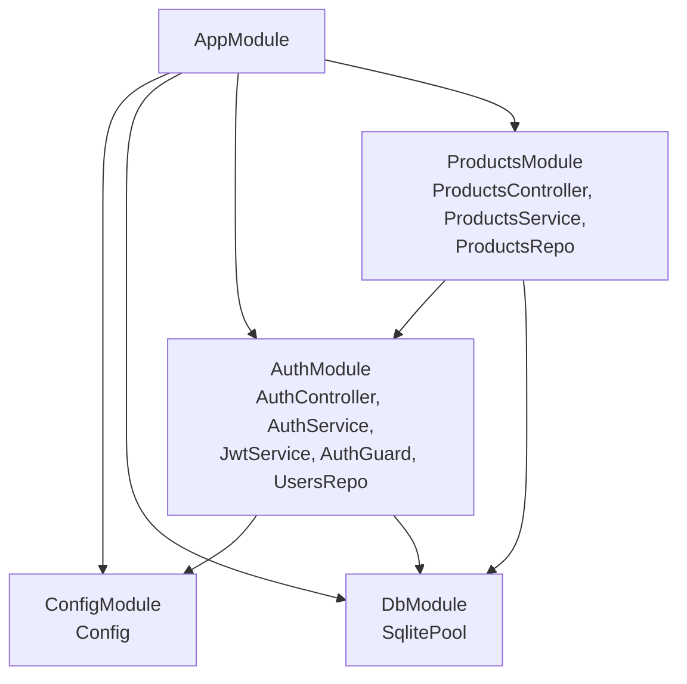

# Shop example

A small, complete eaglet API: people sign up, sign in with a JWT, and sell products that only they can
change. It uses SQLite through SQLx, so it runs with nothing else installed.

```bash
cargo run -p shop            # http://localhost:3000, Swagger UI at http://localhost:3000/docs
cargo test -p shop           # no database server needed
```

## How it fits together



`AuthModule` exports `AuthGuard`, so `ProductsModule` can put `#[guard(AuthGuard)]` on the routes
that change data. Reading the catalog stays public.

| Route | Who | What |
|---|---|---|
| `POST /auth/sign-up` | anyone | Create an account; answers with a token |
| `POST /auth/sign-in` | anyone | Email and password to a token |
| `GET /auth/me` | signed in | The current user |
| `GET /products?limit=&offset=` | anyone | Newest first, 1 to 100 per page |
| `GET /products/:id` | anyone | One product |
| `POST /products` | signed in | Sell a product; you become its owner |
| `PATCH /products/:id` | the owner | Change name or price |
| `DELETE /products/:id` | the owner | Remove it |

## Try it

```bash
TOKEN=$(curl -s -X POST localhost:3000/auth/sign-up -H 'content-type: application/json' \
  -d '{"email":"ana@example.com","password":"correct horse"}' | jq -r .token)

curl -s -X POST localhost:3000/products -H "authorization: Bearer $TOKEN" \
  -H 'content-type: application/json' -d '{"name":"Lamp","price_cents":2500}'

curl -s localhost:3000/products
```

Every error has the same shape, for example a product created without signing in:

```json
{"code":"UNAUTHORIZED","message":"sign in first: send Authorization: Bearer <token>","details":null,"traceId":"fe3f17baf52c93d8"}
```

## Settings

| Variable | Default |
|---|---|
| `PORT` | `3000` |
| `DATABASE_URL` | `sqlite://shop.db?mode=rwc` |
| `JWT_SECRET` | random at startup (tokens stop working after a restart); set it in production |

## Tests

- `tests/flow.rs` runs the whole app against SQLite in memory: sign-up, sign-in, ownership rules,
  validation, and the API docs listing every route.
- `tests/fakes.rs` replaces `ProductsRepo` with a fake through `override_provider` and opens no
  database.
